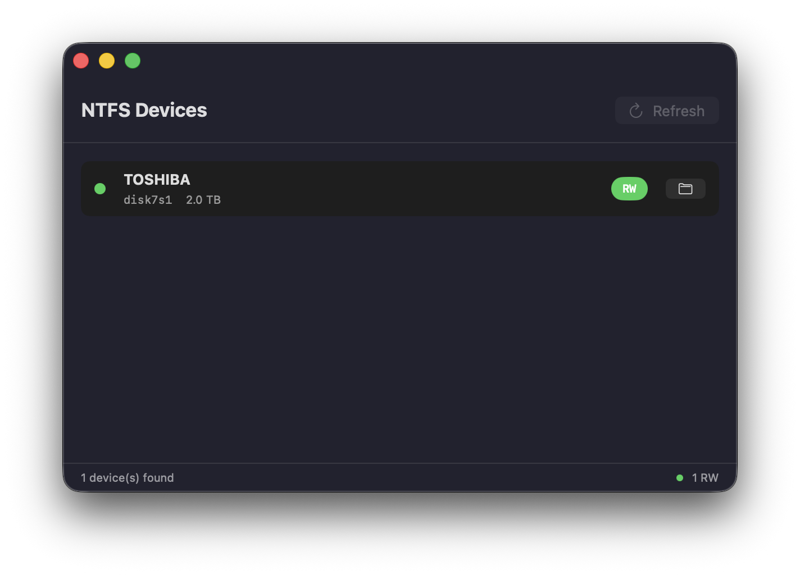

# NTFS4Mac

Una herramienta ligera para macOS que ofrece compatibilidad de lectura/escritura para NTFS. Construida con SwiftUI para macOS 14+ (Sonoma, Sequoia, Tahoe).

<p align="center">
Español | <a href="README_CN.md">简体中文</a>
</p>



## Funcionalidades

- **Montaje de lectura/escritura con un clic** - Remonta volúmenes NTFS a través de ntfs-3g con un solo clic
- **Detección automática de dispositivos** - Observador del sistema de archivos + sondeo detecta nuevas unidades en tiempo real
- **Abrir en Finder** - Acceso rápido a los volúmenes montados
- **Experiencia nativa de macOS** - SwiftUI, modo oscuro, interfaz mínima
- **CLI incluida** - Herramienta de línea de comandos completa para scripts y automatización

## Cómo Funciona

macOS monta nativamente los volúmenes NTFS como solo lectura. Esta herramienta los remonta en modo lectura/escritura utilizando el controlador [ntfs-3g](https://github.com/tuxera/ntfs-3g) a través de [fuse-t](https://github.com/macos-fuse-t/fuse-t).

## Requisitos

| Sistema Operativo | Estado |
|---|---|
| **macOS 26 (Tahoe)** | Probado |
| **macOS 15 (Sequoia)** | Compatible (no probado) |
| **macOS 14 (Sonoma)** | Compatible (no probado) |

## Instalación

### Instalación en un Clic

Ejecute este comando en Terminal para instalar automáticamente todas las dependencias:

```bash
curl -fsSL https://raw.githubusercontent.com/zhouyeyu/NTFS4Mac/main/setup.sh | bash
```

### Instalación Manual

| Dependencia | Propósito | Instalar |
|---|---|---|
| **macOS 14+** | Requerido | Configuración del Sistema > Actualización de Software |
| **fuse-t** | Framework de sistema de archivos | Descargar desde [releases de fuse-t](https://github.com/macos-fuse-t/fuse-t/releases) |
| **ntfs-3g** | Controlador de lectura/escritura NTFS | `brew tap gromgit/fuse && brew install ntfs-3g-mac` |

### Instalar fuse-t

1. Descargue `fuse-t-macos-installer-X.X.X.pkg` desde [releases de fuse-t](https://github.com/macos-fuse-t/fuse-t/releases)
2. Haga doble clic para instalar
3. Otorgue **Acceso completo a disco** a `fuse-t.app` en Configuración del Sistema > Privacidad y seguridad

### Vincular la biblioteca de fuse-t

Después de instalar fuse-t, vincule la biblioteca para ntfs-3g:

```bash
sudo mv /usr/local/lib/libfuse.2.dylib /usr/local/lib/libfuse.2.dylib.bak
sudo ln -sf libfuse-t.dylib /usr/local/lib/libfuse.2.dylib
```

### Instalar la aplicación

Descargue la última versión [DMG desde Releases](../../releases) y arrastre `NTFS4Mac.app` a `/Applications`.

O compile desde el código fuente:

```bash
git clone https://github.com/zhouyeyu/NTFS4Mac.git
cd NTFS4Mac
bash build-dmg.sh
```

### Instalar la herramienta CLI

```bash
git clone https://github.com/zhouyeyu/NTFS4Mac.git
cd NTFS4Mac
make install
```

## Uso

### Interfaz Gráfica (GUI)

Inicie `NTFS4Mac.app`. Inserte una unidad NTFS. Haga clic en **Mount RW**.

- **RW** (verde) = Modo lectura/escritura a través de fuse-t
- **RO** (naranja) = Modo solo lectura (nativo de macOS)
- **--** (gris) = No montado

Haga clic en el icono de carpeta para abrir el volumen en Finder.

### CLI

```bash
ntfs-cli list               # Listar todos los dispositivos NTFS
ntfs-cli mount disk4s1      # Montar como lectura/escritura
ntfs-cli unmount disk4s1    # Desmontar
ntfs-cli eject disk4s1      # Expulsar (seguro para quitar)
ntfs-cli restore disk4s1    # Restaurar modo solo lectura de macOS
ntfs-cli watch              # Montar automáticamente nuevos dispositivos NTFS
ntfs-cli status             # Mostrar estado del montaje
ntfs-cli deps               # Verificar dependencias
```

## Compilación

```bash
swift build -c release      # Compilar aplicación GUI
bash build-dmg.sh           # Compilar y empaquetar DMG
make install PREFIX=/usr/local  # Compilar solo CLI
```

## Estructura del Proyecto

```
NTFS4Mac/
├── NTFS4Mac/                    # Aplicación macOS SwiftUI
│   ├── App/NTFS4MacApp.swift
│   ├── Models/NTFSDevice.swift
│   ├── Services/
│   │   ├── Shell.swift
│   │   ├── DeviceService.swift
│   │   ├── MountService.swift
│   │   └── DeviceWatcher.swift
│   └── Views/
│       ├── DeviceListView.swift
│       └── DeviceRow.swift
├── lib/                         # Scripts CLI
├── ntfs-cli.sh                  # Punto de entrada CLI
├── setup.sh                     # Script de instalación en un clic
├── Package.swift
├── build-dmg.sh
└── Makefile
```

## Problemas Conocidos

- **Primer lanzamiento en macOS**: Es posible que deba hacer clic derecho > Abrir la aplicación en el primer lanzamiento ya que no está firmada.

## Licencia

Licencia MIT

Copyright (c) 2026 zhouyeyu

Se concede permiso, sin cargo, a cualquier persona que obtenga una copia
de este software y los archivos de documentación asociados (el "Software"), para utilizar,
copiar, modificar, fusionar, publicar, distribuir, sublicenciar y/o vender
copias del Software, y permitir a las personas a quienes se les proporcione el Software
hacer lo mismo, sujeto a las siguientes condiciones:

El aviso de copyright anterior y este aviso de permiso se incluirán en todas
las copias o partes sustanciales del Software.

EL SOFTWARE SE PROPORCIONA "TAL CUAL", SIN GARANTÍA DE NINGÚN TIPO, EXPRESA O
IMPLÍCITA, INCLUYENDO PERO NO LIMITADO A GARANTÍAS DE COMERCIALIZACIÓN,
ADECUACIÓN PARA UN PROPÓSITO PARTICULAR Y NO INFRACCIÓN. EN NINGÚN CASO LOS
AUTORES O TITULARES DE LOS DERECHOS DE AUTOR SERÁN RESPONSABLES DE CUALQUIER RECLAMO, DAÑOS U OTRA
RESPONSABILIDAD, YA SEA EN UNA ACCIÓN DE CONTRATO, AGRAVIO O DE OTRO MODO, DERIVADA DE,
FUERA DE O EN CONEXIÓN CON EL SOFTWARE O EL USO U OTRO TIPO DE ACCIONES EN EL SOFTWARE.
